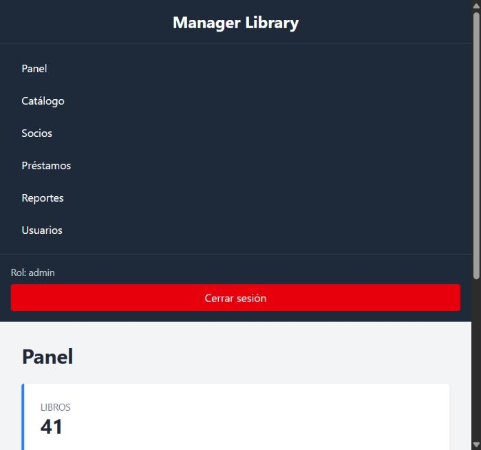
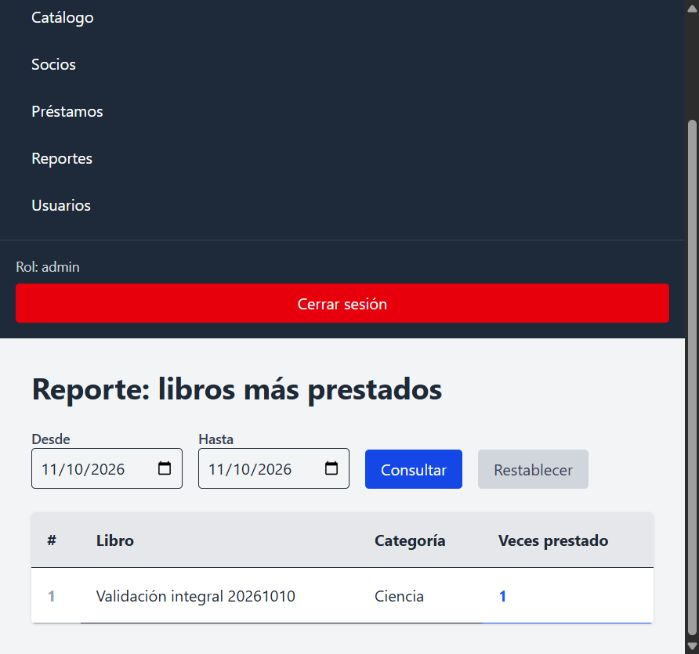

# Entrega local — Manager Library

Verificación realizada el 10–11 de octubre de 2026 en Windows, Docker y PostgreSQL 16. Cambios reales en los seis repositorios. No se realizaron commits, push ni publicación. La matriz definitiva es [COMPLIANCE-MATRIX.md](COMPLIANCE-MATRIX.md).

El estado inicial mostraba API y app con implementación parcial y numerosos archivos sin seguimiento; infra ya tenía cambios locales; page y tool contenían solo README; docs describía una propuesta todavía pendiente. El estado final y la lista de archivos creados/modificados/trasladados por repositorio están en [FILE-INVENTORY.md](FILE-INVENTORY.md) y [repository-status-final.json](evidence/repository-status-final.json). No se atribuyen automáticamente a esta sesión archivos que ya estaban sin seguimiento.

## Resultado y causas corregidas

El administrador puede iniciar sesión, conservarla al recargar, consultar datos reales y cerrar sesión; una ruta privada después del logout redirige al login. No se fabricaron token, rol ni vencimiento ni se modificó su contraseña.

El error de sesión tenía causas combinadas: BOM en `bootstrap/providers.php` contaminaba el JSON; `artisan serve` recargaba el entorno y perdía las variables PostgreSQL de Docker, con lo que HTTP podía usar SQLite aunque CLI usara PostgreSQL; Vite conservaba transformaciones antiguas en el montaje Windows. Se limpió el bootstrap, se activó `--no-reload`, se configuró polling Vite y se validó el contrato de sesión desde React.

El frontend usa `src/main.jsx` y el `src/` exterior. Las carpetas no utilizadas `src/src` y `public/public` se compararon y trasladaron a `../backups/react-duplicates-20261010/`. Se integraron catálogo, edición/baja/portadas, socios, préstamos, devolución por línea, vencidos, reporte y formulario de bibliotecarios. Listados usan `q`, `items`, `page`, `size`, `total`; préstamo usa `items`; reporte usa `rows`/`times_borrowed`. Se añadieron paginación, cargas, errores, vacíos y búsqueda en selectores para no limitar operaciones a los primeros libros/socios.

La API conserva dominio y aplicación independientes del framework. Se unificaron errores, se corrigió el orden de rutas overdue y la conexión de validación de categorías, se firmó rol en JWT, se añadió Argon2id para nuevos hashes conservando bcrypt existente, y se incorporó versión PostgreSQL xmin en la escritura de stock. El préstamo transaccional revierte todas las líneas si una falla; las reglas del socio se serializan. El reporte agrega snapshots históricos en SQL. La portada retirada deja referencia nula y elimina su archivo; no se borró ninguna portada de usuarios durante la validación (Storage fake).

Compose conserva PostgreSQL y su volumen. API usa vendor en volumen Linux y opcache, que resolvieron el coste de lectura Windows en búsqueda. El proxy Vite evita cambiar la API URL entre navegador/contenedores. Start-Library.ps1 valida configuración, inicia servicios, aplica únicamente las dos migraciones library y provisiona admin solo si falta.

`tool/seed-demo.mjs` crea por HTTP 40 libros, 10 socios y 15 préstamos, devuelve 12 y deja 3 abiertos. El sitio `page/index.html` es estático, responsive y funciona sin API. No añade funciones fuera del alcance oficial.

## Pruebas y evidencia

| Verificación | Resultado | Evidencia |
|---|---|---|
| PHP, dominio/aplicación/contrato/PostgreSQL/arquitectura | 116 pruebas, 761 aserciones, sin fallos | [backend-tests.txt](evidence/backend-tests.txt) |
| React build | Compilación correcta | [frontend-build.txt](evidence/frontend-build.txt) |
| React lint | Sin errores ni advertencias | [frontend-lint.txt](evidence/frontend-lint.txt) |
| Sesión frontend | 4 pruebas aprobadas | [frontend-tests.txt](evidence/frontend-tests.txt) |
| Competencia por última copia | Dos procesos y dos HTTP: 201 y 409; stock consistente | ConcurrentLendingTest dentro de salida backend |
| Búsqueda HTTP | 5.008 activos; mediana 117,52 ms; p95 130,27 ms; máximo 156 ms, 20 muestras | [search-benchmark.json](evidence/search-benchmark.json) |
| Sembrador HTTP | 40/10/15 y tres vencidos propios con reloj aislado | [demo-seeder.json](evidence/demo-seeder.json) |
| Esquema | Seis tablas library, cinco categorías, sin DEFAULT, CHECK reales, UTC | [database-tables.txt](evidence/database-tables.txt) y contrato |
| Docker | API y DB healthy, app en ejecución | [docker-status.txt](evidence/docker-status.txt) |
| Comando único de arranque | Start-Library.ps1 exit 0; build cache, nada pendiente de migrar, admin existente intacto | [startup.json](evidence/startup.json) |
| Secretos del log | Claves configuradas ausentes, cero JWT detectados | [log-secret-scan-final.json](evidence/log-secret-scan-final.json) |
| Recorrido navegador | Login, libro, socio, préstamo, recarga, devolución, reporte, logout/ruta protegida | [browser-flow.md](evidence/browser-flow.md), capturas |
| Sitio móvil | 375 px, sin desbordamiento horizontal | [page-mobile.jpg](evidence/page-mobile.jpg) |

## Preservación y cambios en datos

No se sobrescribió .env, no se cambiaron contraseñas, no se eliminaron bases, registros de usuarios, volúmenes ni tablas heredadas; no se usó migrate:fresh, down -v o reset Git. Se creó la base adicional `manager_library_verification`, que se conserva para reproducir resultados. El sembrador, fixture grande y pruebas concurrentes usan datos sintéticos en esa base. Tests de contrato ordinarios usan transacciones revertidas.

El recorrido manual agregó a la base habitual un libro `Validación integral 20261010` (ISBN 9799998887770), un socio sintético con documento `E2E-20261010` y un préstamo ya devuelto. Se conservan como evidencia: panel pasó de 40/10/15 a 41 libros/11 socios/16 préstamos; las tres líneas vencidas existentes no se alteraron.

El log histórico contenía la clave del admin. Se cifró su contenido original con Windows DPAPI CurrentUser, se comprobó recuperación exacta y se guardó en `../backups/security/laravel-original.dpapi`; luego se sustituyeron los valores conocidos por `[REDACTED]` en el log activo. El respaldo cifrado está fuera de los seis repositorios y solo el usuario Windows correspondiente puede descifrarlo. Se conserva escaneo previo y posterior sin revelar secretos. Los nuevos errores no registran SQL, argumentos ni mensajes potencialmente sensibles.

## Límites de certificación

El informe oficial es anonimizado (24 filas Axx): no se identificó una evaluación individual de estos repositorios. La auditoría sigue sus siete dimensiones, pero no fabrica nota ni cambia el informe histórico. No se corrigió el historial de commits/plazo porque no hubo autorización para commits/push.

Las tablas framework heredadas de public se conservan; library cumple su modelo, pero no se afirma que toda la base tenga solo seis tablas. El arranque se verifica sobre la instalación existente y la inicialización se prueba en DB aislada, no en un clon completamente nuevo con descargas de todas las dependencias.

El benchmark es local y caliente, con fixture SQL en DB aislada; no cumple literalmente el método de RNF-1 de crear los 5.000 libros mediante tool ni certifica rendimiento frío/producción. Los tres vencidos del sembrador se verificaron avanzando solo el Clock de un servidor testing dedicado a la DB aislada, nunca el reloj del sistema/base habitual. Sin ese mecanismo un préstamo nuevo vence después de 14 días; el sembrador registra `overdueReadyAt` y permite `--verify` entonces.

Comandos de pruebas y preparación del servidor concurrente en [RUNBOOK.md](../../test-manager-library-3413974-infra/RUNBOOK.md). Comandos ejecutados: `docker compose exec -T -e DB_CONNECTION=pgsql -e DB_DATABASE=manager_library_verification api php artisan test`, `docker compose exec -T app npm test`, `docker compose exec -T app npm run lint`, `docker compose exec -T app npm run build` y `./Start-Library.ps1`. El servidor temporal testing de puerto 8001 se cerró al reiniciar solamente api después de completar pruebas; API normal permanece healthy. Para repetir la suite completa, abrir el servidor aislado indicado en el runbook.

HTTP localhost es para desarrollo. Para publicar se requiere TLS, gestión de secretos y servidor PHP de producción. No hubo despliegue público. Por estas razones no se certifica “100 %” de evaluación histórica, aunque el núcleo funcional local está implementado y probado.
