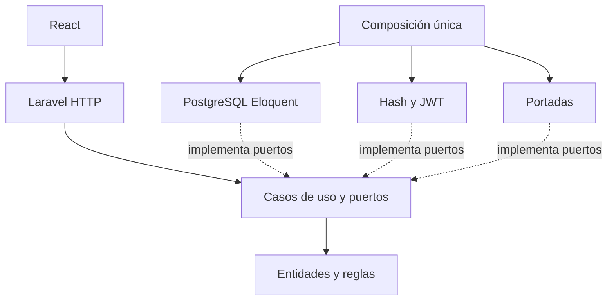

# Arquitectura — Manager Library (Laravel + React)

Este documento conserva el diseño inicial propuesto. La descripción del código realmente implementado está en [ACTUAL-ARCHITECTURE.md](ACTUAL-ARCHITECTURE.md) y su verificación en [FINAL-REPORT.md](FINAL-REPORT.md).

## Fuentes y objetivo
Adaptación de `spec-python/` y `spec-.net/` del repositorio oficial. Se conservan las reglas, historias, contrato HTTP y modelo de datos. Arquitectura propuesta: puertos y adaptadores; las dependencias apuntan hacia el dominio.

## Responsabilidades
| Repositorio | Responsabilidad |
|---|---|
| docs | Especificaciones y decisiones de adaptación |
| api | PHP Laravel, API REST, migraciones, casos de uso |
| app | React, interfaz de operadores |
| page | Sitio público estático, sin API |
| infra | Docker Compose, red, volúmenes, PostgreSQL 16 vacío |
| tool | Sembrador de demostración mediante HTTP, no SQL |

## Dependencias


- Domain no depende de Laravel, Eloquent, Application ni Infrastructure.
- Application depende solo de Domain y declara interfaces pequeñas para repositorios, reloj, hash, tokens y portadas.
- Infrastructure implementa esos puertos; los casos de uso se prueban con fakes.
- Un único proveedor `LibraryBindingsProvider` enlaza puertos y adaptadores.
- HTTP valida entrada, controla permisos y transforma errores de negocio al contrato único.

## Árbol propuesto de API
```text
api/
├── app/
│   ├── Domain/{Book,Loan,Member,User}/
│   ├── Application/{Ports,UseCases}/
│   ├── Infrastructure/{Persistence,Security,Storage,Time}/
│   ├── Http/{Controllers/Api/V1,Middleware,Requests}/
│   └── Providers/LibraryBindingsProvider.php
├── database/migrations/
├── routes/api.php
└── tests/{Unit,Feature,Integration,Architecture}/
```

## Árbol propuesto de React
```text
app/src/
├── api/
├── auth/
├── components/
├── features/{books,members,loans,overdue,reports}/
├── pages/
└── main.jsx
```
Estas estructuras son decisiones de implementación propuestas, no archivos ya existentes.

## Modelo y migraciones
PostgreSQL 16, esquema `library`, tablas singulares `category`, `book`, `member`, `loan`, `loan_item`, `user`. UUID v4; fechas UTC; sin columnas genéricas de auditoría ni DEFAULT. Las migraciones Laravel son dueñas del esquema, restricciones, índices y semilla de cinco categorías. Infraestructura no contiene CREATE TABLE. El admin inicial se crea desde variables de entorno.

## Contrato y seguridad
- Base `/api/v1`; JSON con snake_case, UUID v4, fechas ISO 8601 UTC con Z.
- JWT Bearer firmado con vigencia de 8 horas; roles admin y librarian.
- Solo login y health públicos; socios no inician sesión.
- CORS limitado al origen configurado.
- Hash Argon2id tras un puerto; secretos en entorno y nunca en Git ni logs.
- Portadas JPG/PNG máximo 2 MB verificadas por contenido; guardar `cover_key` opaco, no ruta física.
- Errores uniformes `{code,message,details}` con estados 401/403/404/409/422.

## Reglas transaccionales
- Préstamo de 1 a 3 libros distintos; máximo 3 libros sin devolver por socio; vencimiento a 14 días; socio con vencidos bloqueado.
- Crear préstamo, líneas y descontar stock en una sola transacción; bloquear filas pertinentes para evitar sobreventa y carreras entre préstamos del mismo socio. Documentar esta elección frente al ADR de concurrencia optimista del spec.
- Cada línea congela título, ISBN y categoría. El reporte histórico usa esas copias, no el catálogo actual.
- Devolución de una línea incrementa exactamente un ejemplar; segundo intento responde 409.
- Estado open/overdue/closed y días de atraso se calculan, nunca se almacenan.
- Préstamos inmutables, libros con baja lógica.

## Pruebas exigibles
Dominio sin framework, casos de uso con fakes, integración PostgreSQL, contrato HTTP, permisos, pruebas de arquitectura, concurrencia del último ejemplar (201 y 409), historial congelado, y ausencia de secretos. Una tarea solo se marca terminada con evidencia ejecutable.
